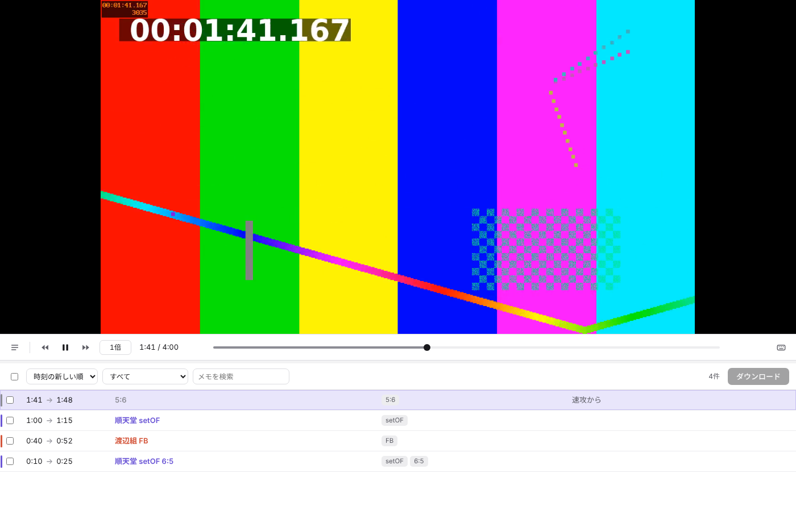

# Moment

ハンドボールの試合映像を見ながらキー操作でシーンにタグを付け、シーンごとの動画ファイルとしてダウンロードするアプリです。

仕様の正本は [SPEC.md](SPEC.md) です。



## はじめて動かす（Mac）

1. **Node.js を入れる**
   ターミナルで `node -v` と打ちます。`v20` 以上の数字が出れば入っています。出なければ [nodejs.org](https://nodejs.org/) から LTS 版をインストールしてください。
2. **このフォルダに移動する**
   ```
   cd ~/Handball/moment2
   ```
3. **必要なものを入れる**（初回だけ。Electron と ffmpeg をダウンロードするので数分かかります）
   ```
   npm install
   ```
4. **起動する**
   ```
   npm start
   ```

2回目からは、2 と 4 だけで起動できます。

## アプリにする（Moment.app）

ターミナルでこのフォルダに移動して、次を実行します。

```
npm run dist
```

`dist` フォルダに `Moment.app` ができます。Finder でアプリケーションフォルダにドラッグすれば、ほかのアプリと同じようにダブルクリックや Launchpad から開けます。

- 前に Xcode で作った Moment.app がアプリケーションフォルダにある場合は、「置き換える」を選びます
- アプリを直したときは、もう一度 `npm run dist` を実行して入れ直します
- 作業ログと設定は `npm start` で起動したときと同じものを使います
- 自分のMac用のアプリです。ほかのMacに渡すと、警告が出て開けないことがあります

## 使い方

1. 左の「新しく始める」で試合の動画を選び、試合名とチームA・Bの名前を入れる
2. 試合を見ながら `、` で開始 → ショートカット（`1` など）でタイトルとタグを付ける → `。` で終了
3. 下の一覧でシーンを確認する。行をクリックするとその区間を再生し、選んだ行の欄をもう一度クリックすると書き換えられる
4. ダウンロードしたい行にチェックを入れて「ダウンロード」を押す

途中でやめても、作業ログから続きを開けます。動画の名前を変えたり、別の場所に移したりしても、同じ動画だと分かります。

## 最初のキー

| キー | 操作 |
| --- | --- |
| `、` / `。` | 記録を開始 / 終了 |
| `F1` | 記録を取り消す（MacBook では `fn` を押しながら） |
| `1` `2` `3` | チームA の setOF / FB / PT |
| `8` `9` `0` | チームB の setOF / FB / PT |
| `W` `E` `R` `T` | 6:5 / 5:6 / 7:6 / 6:7 |
| `Space` | 再生 / 停止 |
| `←` / `→` | 3秒戻る / 進む |
| `↓` / `↑` | 速度を下げる / 上げる |
| `⌘K` | キー表示ウインドウを出す / 隠す |

キーと名前は、左の「設定」から変えられます。

## フォルダの中身

| 場所 | 中身 |
| --- | --- |
| `SPEC.md` | 仕様（正本） |
| `main/` | アプリの裏側。ウインドウ、作業ログの保存と確かめ（`worklog.js`）、ffmpeg での切り出しと結合 |
| `src/` | 画面。`app.js` が作業画面と起動画面、`keys.*` がキー表示ウインドウ |
| `src/lib/core.js` | タイトル、ファイル名、キーの決まりごと |
| `tests/` | 決まりごと・作業ログの保存と確かめ・書き出しのテスト。`npm test` で動きます。本物の ffmpeg の代わりに `fake-ffmpeg.js` を使い、一時フォルダは `tests/` の中に作って最後に消します |
| `build/` | アイコン（`icon.png` と Mac用の `icon.icns`） |
| `scripts/build-mac.js` | `npm run dist` で Moment.app を作る手順 |
| `docs/` | 仕様書と README の図 |

作業ログと設定は、Mac では `~/Library/Application Support/Moment` に保存されます。動画ファイルそのものは保存しません。

## うまく動かないとき

- **「ffmpeg が見つかりません」と出る**：`npm install` をもう一度実行してください
- **`F1` が効かない**：`fn` を押しながら `F1`。または macOS の設定で「F1、F2などのキーを標準のファンクションキーとして使用」をオンにする
- **動画が開けない**：MP4 や MOV（H.264 / HEVC）なら開けます。それ以外は、一度 MP4 に変換してください

## まだやっていないこと

- ほかの人に配れる形（Appleの署名付き）や Windows 版にまとめること
