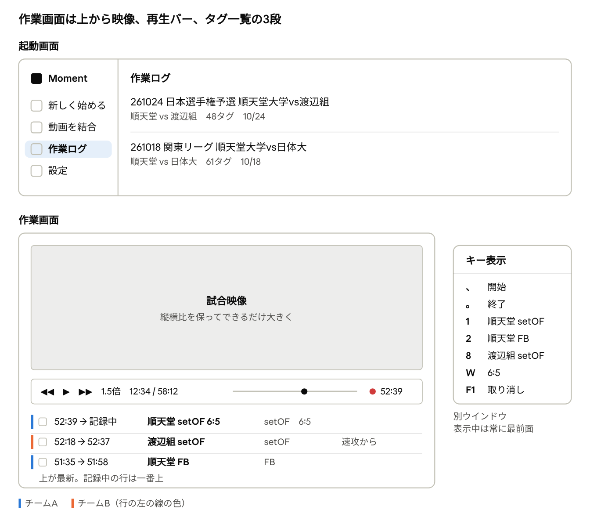

# Moment 仕様書（Electron版）

最終更新：2026-10-30

この SPEC.md が Moment の仕様の正本です。PREFLIGHT.md と SPRINT1.md を置き換えます。追加の要件を差分で積み重ねず、変更があるときはこの文書の該当箇所を直接書き換えます。

## 目的と範囲

Moment は、ハンドボールの1試合通しの映像を見ながらキー操作でシーンを記録し、シーンごとの動画ファイルとしてダウンロードするアプリです。両チームの攻撃を記録できるので、自チームが出ていない試合にも使えます。

**やること**

- 動画を開いて再生する（倍速とスローを含む）
- `、` と `。` で区切ったシーンに、ショートカットでタイトルとタグを付ける
- タグ一覧で確認・修正し、メモを書く
- 選んだシーンを別々に、または1本に結合してダウンロードする
- 複数の動画を1本に結合する
- 複数の試合から選んだシーンをプレイリストにまとめ、決めた順に続けて再生する・ダウンロードする
- 作業ログに記録を残し、動画をはめ込んで再開する

**やらないこと**

- ログイン、クラウド保存、共有、AIによる自動判定、統計
- 今のアプリにある Code Window、行とタググループ、箱を線で結ぶ機能
- ダウンロード時の前後の余白、作業時間の記録、開始キーの省略
- 動画ファイルそのものをアプリに保存すること

**動作環境**

- 最初はM1のMacで使う。Electron で作り、動画の切り出しと結合に使う ffmpeg はアプリに同梱する
- 将来はほかのMacとWindowsにも対応する。そのため `⌘` のショートカットはWindowsでは `Ctrl` に置き換え、作業ログはどちらでも読める形式にする
- 自分のMacで使うアプリ（Moment.app）は `npm run dist` で作る。Appleの署名はせず、そのMacの中だけで使う
- 人に配る形（Appleの署名付きのアプリ）と Windows 版にまとめるのは後の段階

## 画面構成

画面は「起動画面」「作業画面」「プレイリスト画面」「キー表示ウインドウ」の4つです。設定やダウンロードの確認は、この中に開きます。



キー表示ウインドウは作業画面とは別に開き、表示している間は常に前に出ます。図の中の試合名、時刻、タグ数は説明用の例です。

### 起動画面

- 左に縦一列のアイコンを並べる：アプリのアイコン、新しく始める、動画を結合、作業ログ、プレイリスト、設定
- 右側に選んだものの中身を出す。起動直後は作業ログ

### 作業画面

- 上：試合映像。縦横比を保ったままできるだけ大きく出す
- 中：再生バー。再生 / 停止、3秒戻し、3秒早送り、速度、現在時刻 / 全体の長さ、再生位置のバー、記録中の表示
- 下：タグ一覧。上が最新
- 映像の下の境目（映像と再生バーの間）を上下にドラッグすると、映像とタグ一覧の高さの比率を変えられる。つまみなどの目印は置かない。比率は次に開いたときも同じ
- ウインドウのタイトルは「動画のファイル名 - Moment」
- 記録中の表示は、点滅する赤い点と開始時刻だけ。記録していないときは何も出さない
- 「どちらのチームが少ないか」のような状態は画面に出さない
- 再生バーの左端に「作業ログに戻る」、右端に「キー表示」のボタンを置く
- タグ一覧の上に、並び順、絞り込み、メモの検索、件数、「プレイリストに追加」、「ダウンロード」を並べる

### プレイリスト画面

- 作業画面と同じく、上が映像、中が再生バー、下がプレイリストのシーンの一覧（再生する順）。映像と一覧の高さの比率は作業画面と同じものを使い、境目のドラッグで変えられる
- ウインドウのタイトルは「プレイリスト名 - Moment」
- 再生バーには、左から「プレイリストに戻る」、前のシーン、再生 / 停止、次のシーン、速度、そのシーンの中の再生位置（経過 / シーンの長さ）、再生位置のバー（そのシーンの開始から終了まで）、何本目か（例：3 / 12）を並べる
- 一覧の上に、プレイリスト名、本数と合計の長さ、「ダウンロード」を並べる

### キー表示ウインドウ

- 登録したショートカットの名前とキーを並べる、別のウインドウ
- 表示している間は常に最前面に出る。全画面の映像の上にも出る
- `⌘K` で表示 / 非表示を切り替える（キーは設定で変えられる）

### 見た目

- 設定で「ライト」「ダーク」「Macの設定に合わせる」を選ぶ。映像の周りはどちらでも黒
- アイコンはドット絵のノートパソコン。背景は黒で、角丸の四角
- タイトルの文字と行の左端の線は、チームAとチームBで色を分ける。チームなしは灰色
- ウインドウの大きさと位置は、前回の状態を覚えておく
- 時刻は「分:秒:ミリ秒」で出す（例：05:03:120）。分は2桁、ミリ秒は3桁。1時間を超えたら「時:分:秒:ミリ秒」（例：1:02:15:000）。再生バー（作業画面・プレイリスト画面）、記録中の表示、動画を結合の長さは、この形
- 一覧（タグ一覧、プレイリストのシーンの一覧と合計の長さ）の時刻は、ミリ秒を出さずに「分:秒」で出す（例：05:03）。1時間を超えたら「時:分:秒」（例：1:02:15）

## 作業ログ

作業ログは試合ごとの記録の入れ物です。動画そのものは保存せず、作業のたびに動画をはめ込んで再開します。

### 新しく始める

1. 左の「新しく始める」を押して、動画を選ぶ（ドラッグ＆ドロップも可）
2. 試合名、チームAの名前、チームBの名前を入れる。試合名の初期値は動画のファイル名。チーム名は空でもよい
3. 設定で「タグ付けを始める前にショートカット設定を表示する」がオンなら、ショートカット設定を開く
4. 作業画面に入る。作業ログが1件増える

すでに作業ログがある動画を選んだときは、新しく作らずその作業を再開します。

### 再開する

1. 作業ログで試合をクリックする
2. 前回の場所に同じ動画があれば、そのまま開く。なければ「動画を選んでください（前回：〜.mov）」と出す
3. 選んだ動画が同じものかを指紋で確かめる。同じならタグを戻し、前回止めた位置で一時停止した状態で開く
4. 指紋は違うが動画の長さ（「動画を調べる」のとおり ffmpeg で調べる）が同じ（差が1秒以内）なら、「前回の動画と中身が少し違います。この動画で再開しますか？」と確かめる。「再開する」を選ぶと、作業ログの指紋をこの動画のものに置き換えて、3と同じように開く。ダウンロードし直した動画など、映像は同じでもファイルの中身が変わった場合のため。前回の場所にある動画が指紋だけ違う場合も同じように確かめる
5. 長さも違う動画なら「この作業の動画と違います」と出して、開かない。選んだ動画の長さを調べられなかったときは、「動画を調べる」の理由を出して開かない（前回の場所の動画を調べられなかったときは、動画を選んでもらう）

### 動画の見分け方

- ファイル名や場所ではなく、中身の指紋で見分ける。指紋は、ファイルサイズ、動画の長さ、先頭・真ん中・末尾から読んだ一部のデータから作る
- 名前の変更、フォルダの移動、外付けドライブへのコピーをしても、同じ動画と分かる
- 圧縮し直した動画や一部を切った動画は、別の動画として扱う。ただし再開するときは、長さが同じなら確かめたうえで開ける（「再開する」の4）

### 一覧と編集

- 一覧は1試合1行で、試合名、「チームA vs チームB」、タグ数、最後に作業した日を横に並べる
- 試合名とチーム名はあとから直せる。直すとタイトルにも反映される
- 削除するときは確認を出す（1試合分のデータが消えるため）。その試合のシーンを入れたプレイリストでは、その行が「元のシーンがありません」になる
- 作業ログをファイルに保存し、別のMacやWindowsで読み込める（「ファイルから読み込む」）

### ファイルから読み込む

ファイルに保存した作業ログは、メニューの「作業ログを読み込む」で取り込みます。取り込む前に中身を確かめ、受け取ったデータをそのまま保存せず、確かめた項目だけで作業ログを作り直します。

- 正しくないところがあれば取り込まず、今ある作業ログも書き換えない。「作業ログを読み込めません（理由）」と出す。理由は「シーン3：終了が開始より後になっていません」のように、どこが正しくないかを書く
- 同じ作業ログがすでにあれば、上書きするかを確かめる。確かめるのは中身が正しいと分かってから
- ID がない、または形が正しくないときは、新しい ID を振る

| 確かめること | 決まり |
| --- | --- |
| ファイル | 20MB まで。JSON として読めて、Moment の作業ログの印がある |
| バージョン | 1 だけに対応 |
| 必ずある項目 | バージョン、ID、動画の指紋、シーンの一覧 |
| 型 | 文字列・数・配列・まとまり（オブジェクト）が、項目ごとに決まった形になっている |
| ID | 作業ログ・シーン・タグ（ショートカットの内部番号）の ID は、英数字とハイフンで64文字まで。シーンの ID は重ならない |
| 時刻 | 開始と終了は有限の数。開始は0以上、終了は開始より後。動画の長さが分かっているときは、終了が長さを2秒より超えない（長さが少し違う動画で再開した場合のゆとり） |
| 数の上限 | シーン 10000件、1シーンのタグ 100個、ショートカット 1000件 |
| 文字数の上限 | 試合名・チーム名・タイトル 1000文字、メモ 20000文字、ショートカットの名前 200文字、動画のファイル名 1024文字、動画の場所 4096文字 |
| ショートカット | 一緒に入っているショートカットの名前の控えも、ID・名前・チーム（A / B / なし）を確かめる |

なくてもよい項目がないときは、次の値で補います：試合名・チーム名・メモは空、手で書き換えたタイトルはなし、タグはなし、前回止めた位置は0、動画の長さは不明、作った順は一覧の順に振り直す。決まりにない項目は取り込みません。

アプリの中に保存している作業ログを開くときと保存するときも、同じ決まりで確かめます（「データの保存」）。

## タグ付けの操作

シーンは `、` で始めて `。` で終えます。その間に押したショートカットで、タイトルとタグが付きます。

1. `、` を押す。その瞬間の再生位置が開始時刻になる。タグ一覧の一番上に「開始時刻 → 記録中」の行ができ、再生バーに点滅する赤い点と開始時刻が出る
2. 記録中にショートカットを押す（例：`1` = 順天堂 setOF、`W` = 6:5）。その行にタイトルとタグが足されていく。同じキーをもう一度押すと、そのタグが外れる
3. `。` を押す。その瞬間の再生位置が終了時刻になり、シーンが確定する。赤い点と開始時刻の表示は消える

- 記録中に `、` をもう一度押すと、開始時刻を今の位置に移す。付けたタグはそのまま
- `F1` で記録を取り消す。記録中の行は消える。記録していないときの `F1` は何もしない
- 動画は止まらない。確定したら、すぐ次の `、` を押せる
- 記録中に再生位置を動かしたり、速度を変えたりしてもよい
- 記録中の行は、並び順や絞り込みに関係なく一番上に出す
- 時刻は押した瞬間の再生位置をそのまま記録する（画面に出す形は「見た目」のとおり）
- 確定する前の記録は保存しない。アプリを閉じると消える

### タイトルの決まり方

- ショートカットは「名前」と「チーム（A / B / なし）」を持つ
- 押すと、その名前がタグになる
- タイトルは、押した順に「チーム名＋名前」をつなげたもの。チームなしは名前だけ
- チーム名が空のときは「チームA」「チームB」を使う
- 何も押さずに `。` を押したら、タイトルなしで確定する。あとから一覧で付けられる

| 押したキー | タイトル | タグ |
| --- | --- | --- |
| `、` → `1`（A：setOF）→ `。` | 順天堂 setOF | setOF |
| `、` → `1`（A：setOF）→ `W`（なし：6:5）→ `。` | 順天堂 setOF 6:5 | setOF、6:5 |
| `、` → `9`（B：FB）→ `。` | 渡辺組 FB | FB |
| `、` → `。` | （なし） | （なし） |

## 再生操作

再生はキーでも、再生バーのボタンでも操作できます。キーは設定で変えられます。

| 操作 | 初期のキー | 内容 |
| --- | --- | --- |
| 再生 / 停止 | Space |  |
| 3秒戻る / 3秒進む | ← / → | 0秒より前、動画の終わりより後には行かない |
| 速度を下げる / 上げる | ↓ / ↑ | 0.25 / 0.5 / 0.75 / 1 / 1.2 / 1.5 / 2倍を順に切り替える |

- 今の速度は再生バーに常に表示する
- 再生位置のバーは、クリックやドラッグで好きな位置へ飛べる
- 全画面（緑のボタン、または `⌃⌘F`）にしても、映像・再生バー・タグ一覧の画面のまま、画面いっぱいに広げる。キー操作はすべて使え、キー表示ウインドウは全画面の上にも出る
- 作業を再開したときは、前回止めた位置で一時停止した状態で開く
- メモや時刻など、文字を入力している間はショートカットを働かせない

## タグ一覧

タグ一覧は1行1シーンで、映像の下に溜まっていきます。初期の並びは時刻の新しい順です。

| 欄 | 内容 |
| --- | --- |
| チェック | ダウンロードする行を選ぶ |
| 開始 → 終了 | 例：52:39 → 52:51。1時間を超えたら 1:02:15 |
| タイトル | チームの色で表示する |
| タグ | 付いているタグ |
| メモ | 自由に書ける |

### 並び順と絞り込み

- 並び順：時刻の新しい順（初期）、時刻の古い順、作った順、タイトル順
- 絞り込み：タイトル、チーム、タグ、メモに含む文字
- 絞り込んだ行をまとめてチェックできる
- チェックした行は「ダウンロード」でダウンロードするほか、「プレイリストに追加」でプレイリストに入れられる（「プレイリスト」）

### 見返す・直す

- 行をクリックすると、その区間を開始から再生して終了で止まる。その行は選ばれた状態になる
- 選んでいる行の開始・終了・タイトル・メモの欄をもう一度クリックする（またはダブルクリックする）と、その場で書き換えられる。Enterで確定、Escでやめる
- 時刻は表示と同じ形で入れる（例：52:39）。再生バーと同じミリ秒までの形でも入れられる（例：52:39:120）
- 開始が終了より前で、どちらも動画の範囲内のときだけ確定できる
- タイトルを手で書き換えた行は、その後にチーム名やショートカットの名前を変えても自動では変わらない
- 選んだ行は `Delete` で削除する。確認は出さない
- `⌘Z` で元に戻し、`⇧⌘Z` でやり直す。対象は、シーンの確定・削除・書き換え・タグの付け外し

### あとからタグを付ける

方法は設定で選びます。

- **キーで付ける**：行を選んでショートカットを押すと、そのタグが付く。もう一度押すと外れる。記録していないときだけ働く
- **マウスで付ける**：タグの欄をクリックすると、登録しているタグの一覧が出て、そこから選ぶ

## プレイリスト

複数の試合から選んだシーンを、決めた順に続けて再生したり、ダウンロードしたりするための入れ物です。シーンそのものは作業ログに残り、プレイリストは「どの作業ログのどのシーンか」と順番だけを覚えます。

### 作る・一覧

- 起動画面の左の「プレイリスト」で一覧を出す。1行1つで、名前、シーンの本数、合計の長さ、最後に変えた日を横に並べる
- 「新しいプレイリスト」で名前を入れて作る。作業画面の「プレイリストに追加」からも作れる。名前が空なら「新しいプレイリスト」
- 名前はあとから直せる
- 削除するときは確認を出す。中のシーン（作業ログ）と動画ファイルは消えない
- 行をクリックすると、プレイリスト画面を開く
- プレイリストはこのMacの中だけで使う。ファイルへの保存と読み込みはしない

### シーンを入れる

1. 作業画面のタグ一覧で、入れたい行にチェックを入れる（絞り込んでまとめてチェックしてもよい）
2. 「プレイリストに追加」を押し、出てきたプレイリストの一覧から入れ先を選ぶ。一覧の最後の「新しいプレイリスト」で、名前を入れて作り、そこに入れることもできる
3. チェックした行が、試合の時刻順でプレイリストの最後に入る。「〜に3本を追加しました」と出す。チェックはそのまま残す

- 別の試合を開いて同じように入れると、複数の試合のシーンが1つのプレイリストに入る
- 同じシーンは1つのプレイリストに1回だけ入る。すでに入っているシーンは入れず、「（2本はすでに入っています）」と添える
- チェックが0件のうちは「プレイリストに追加」を押せない

### 並べ替え・外す

- プレイリスト画面の一覧は、再生する順に並ぶ。1行1シーンで、つまみ、番号、試合名、開始 → 終了、タイトル（チームの色）、タグ、メモ、外すボタンを並べる
- 行をドラッグして順番を変える
- 外すボタン、または行を選んで `Delete` で、プレイリストから外す。確認は出さない。シーンそのもの（作業ログ）は消えない
- 再生しているシーンを外したときと、プレイリストが空になったときは、映像を消して黒にする

### メモ

- メモはプレイリスト画面でも書ける。選んでいる行のメモの欄をもう一度クリックする（またはダブルクリックする）と、その場で書き換えられる。Enterで確定、Escでやめる
- メモは、その試合の作業ログにあるシーンのメモそのもの。作業画面で書いてあったメモはそのまま出て、プレイリスト画面で書いたメモは作業画面のタグ一覧にも出る
- シーンの時刻・タイトル・タグは作業画面で直す。直した内容は、プレイリストにもそのまま出る

### 続けて再生する

- 「再生」で、選んだ行（なければ1本目）のシーンから再生する。各シーンは開始から終了まで流し、終わったら次のシーンへ自動で進む。最後のシーンが終わったら止まる
- 行をクリックすると、そのシーンを開始から再生し、そのまま次のシーンへ続く。その行は選ばれた状態になる
- 「前のシーン」「次のシーン」で前後のシーンへ移る。再生しているシーンの行には印を付ける
- キーは作業画面と同じ（再生 / 停止、3秒戻る / 進む、速度を下げる / 上げる）。3秒戻る / 進むと再生位置のバーは、そのシーンの開始から終了の間で動く
- 速度は、シーンが変わってもそのまま
- 選んだ行は `Esc` で選ばない状態に戻す

### 動画を見つける

- プレイリスト画面を開いたとき、試合ごとに、動画が前回の場所にあって指紋が同じかを確かめる
- 見つからない試合のシーンは、行に「動画が見つかりません」と出し、続けて再生するときは飛ばす。その行をクリックすると「動画を選んでください（前回：〜.mov）」と出し、「再開する」の2〜5と同じ決まりで確かめる。確かめられたら、その試合のシーンはすべて再生できるようになり、作業ログの動画の場所（と、置き換えたときは指紋）も新しいものにする
- 元のシーンや作業ログが消えていたり、作業ログを開けなかったりしたら、行に「元のシーンがありません」と出し、再生とダウンロードでは飛ばす。外すことはできる

### プレイリストのダウンロード

- プレイリスト画面の「ダウンロード」で、プレイリストのシーン全部を、プレイリストの順にダウンロードする。確認画面と進み方は「ダウンロード」と同じ（書き方、保存先、画質を選ぶ）
- 保存先の中にプレイリスト名のフォルダを1つ作り、その中に全部入れる。同じ名前のフォルダがあれば「〜 2」を作る
- 別々にダウンロードするときのファイル名は「番号＋タイトル」（例：01 順天堂 setOF.mp4）。番号はプレイリストの順で、桁は「フォルダとファイル名」と同じ。タイトルのない行は「01 タイトルなし.mp4」
- 1本に結合するときは、確認画面で入れたタイトルをファイル名にし、プレイリストの順につなぐ。タイトルの初期値はプレイリスト名
- 違う動画のシーンを1本に結合するときは、つなげるように映像の大きさ・コマ数・音声をそろえる。大きさは、画質が 1080p なら 1920×1080、720p なら 1280×720、元の解像度なら最初のシーンの動画に合わせる。縦横比は保ち、余白は黒で埋める。コマ数は最初のシーンの動画に合わせ、音声のない動画は無音にする
- 動画が見つからない行と元のシーンがない行は入れない。確認画面に「動画が見つからない2本は入りません」のように出す。入れられるシーンが0本なら「ダウンロード」を押せない
- 書き出し方は「既存のファイルを守る」のとおり

## ショートカット設定

ショートカットは「名前」「チーム」「キー」の3つを持ち、自由に追加・変更・削除・並べ替えができます。設定は全試合で共通です。

| 項目 | 内容 |
| --- | --- |
| 名前 | タグとタイトルになる文字。例：setOF、6:5 |
| チーム | A / B / なし。AかBなら、タイトルの前にその試合のチーム名が付く |
| キー | 1つのキー、または Shift との組み合わせ |

- キーの欄をクリックしてからキーを押すと割り当たる
- キーは物理的な位置で判定する。日本語入力のオン・オフに関係なく動く
- 同じキーは2つに割り当てられない。押した時点で「〇〇で使っています」と出す
- `⌘` との組み合わせはメニュー用なので使えない
- 名前を変えると、過去の試合のタグとタイトルも新しい名前になる。シーンはタグを名前ではなく内部の番号で覚えるため
- 削除しても、過去の試合のタグは残る。キーとキー表示から外れるだけ

### 基本操作のキー

名前は固定で、キーだけ変えられます。

| 操作 | 初期のキー |
| --- | --- |
| 記録を開始 | `、` |
| 記録を終了 | `。` |
| 記録を取り消す | `F1` |
| 再生 / 停止 | Space |
| 3秒戻る / 3秒進む | ← / → |
| 速度を下げる / 上げる | ↓ / ↑ |
| キー表示の表示 / 非表示 | `⌘K` |

MacBook では、`F1` は `fn` を押しながら押します。macOSの設定「F1、F2などのキーを標準のファンクションキーとして使用」をオンにすると、単独で押せます。

メニューのショートカットは次のとおりです（Windowsでは `⌘` が `Ctrl` になります）。

| 操作 | キー |
| --- | --- |
| 新しく始める | `⌘N` |
| 作業ログに戻る | `⌘L` |
| ダウンロード | `⌘D` |
| 設定 | `⌘,` |
| 元に戻す / やり直す | `⌘Z` / `⇧⌘Z` |
| 全画面 | `⌃⌘F` |

### 初期値

最初に起動したときに入っているショートカットです。ここから直して使います。

| チーム | 名前 | キー |
| --- | --- | --- |
| A | setOF | 1 |
| A | FB | 2 |
| A | PT | 3 |
| B | setOF | 8 |
| B | FB | 9 |
| B | PT | 0 |
| なし | 6:5 | W |
| なし | 5:6 | E |
| なし | 7:6 | R |
| なし | 6:7 | T |

## 動画を結合

前半・後半などに分かれた動画を、1本の動画にまとめます。

1. 左の「動画を結合」を押して、動画を追加する（複数選択、ドラッグ＆ドロップも可）。追加した動画は、長さと形式を調べる（「動画を調べる」）
2. ドラッグで順番を並べ替える
3. タイトル（保存するファイル名）と画質を決める
4. 保存先を選んで結合する。進み具合を表示し、途中で中止できる。保存先に同じ名前のファイルがあれば結合せず、「同じ名前のファイルがあります」と出す。書き出し方は「既存のファイルを守る」のとおり
5. 終わったら「ここで終わる」か「そのままタグ付けに入る」を選ぶ。タグ付けに入ると、「新しく始める」の試合名とチーム名の入力に進む

| 画質 | 内容 |
| --- | --- |
| 元のまま | 画質が落ちず、数分で終わる。同じカメラ・同じ設定で撮った動画同士に限る |
| 1080p | 形式が違う動画同士でも結合できる |
| 720p | 形式が違う動画同士でも結合でき、ファイルが軽くなる |

形式が違う動画を「元のまま」で結合しようとしたときは、始める前に止めて 1080p か 720p を選んでもらいます。

## 動画を調べる

再開するときとプレイリスト画面で動画を選んだとき（長さ）、動画を結合するときと、プレイリストで違う動画のシーンを1本に結合してダウンロードするとき（長さと形式）、ダウンロードや結合を始めるとき（使える書き出し方式）は、ffmpeg で調べます。

- 調べる処理は裏で動かす。調べている間も画面は止まらず、操作できる
- 時間の上限を決める。動画を調べるのは30秒、書き出し方式の確認は15秒。過ぎたら ffmpeg を止める
- ffmpeg から受け取る出力は1MBまで。超えたら ffmpeg を止め、受け取った分だけで読む
- うまくいかなかった理由は、次の3つを分けて出す

| 起きたこと | 出す文言 |
| --- | --- |
| 時間切れ | 動画を調べるのに時間がかかりすぎました（書き出し方式の確認では「ffmpeg の確認に時間がかかりすぎました」） |
| ffmpeg を起動できない | ffmpeg を起動できません（ffmpeg が見つからないときは「ffmpeg が見つかりません」） |
| 調べた結果を読み取れない | この形式の動画は開けません（動画を結合で追加するときと、プレイリストを1本に結合してダウンロードするときは「〜 を読み込めません」） |

- 止めた ffmpeg は残さない。うまくいかなかった結果は覚えておかず、次に調べるときはやり直す
- 結合やダウンロードを中止したときは、調べている途中の ffmpeg も止める

## ダウンロード

押した開始秒から終了秒までを、ずれなく切り出すことを最優先にします。そのため、切り出しのたびに映像を作り直す方式にします。少し時間はかかりますが、区切りの位置はずれません。

1. タグ一覧で、ダウンロードする行にチェックを入れる。チェックが0件のうちは「ダウンロード」を押せない
2. 「ダウンロード」を押すと、確認画面が1枚出る
3. 確認画面で、書き方（別々にダウンロード / 1本に結合してダウンロード）、保存先（前回の場所を覚えておく）、画質（元の解像度 / 1080p / 720p）を選ぶ。本数とファイル名の例もここに出す
4. 「〇本をダウンロード」を押すと、同じ画面に進み具合が出る。途中で中止できる
5. 終わったら、成功と失敗の一覧と「Finderで表示」（Windowsでは「エクスプローラーで表示」）を出す

### フォルダとファイル名

ダウンロードするたびに、保存先の中へ試合名のフォルダを1つ作り、その中に全部入れます。種類ごとのフォルダ分けはしません。

```
選んだ保存先/
└ 261024 日本選手権予選 順天堂大学vs渡辺組/
   ├ 順天堂 setOF 01.mp4
   ├ 順天堂 setOF 02.mp4
   ├ 順天堂 setOF 6-5 01.mp4
   └ 渡辺組 FB 01.mp4
```

- ファイル名は「タイトル＋番号」。番号は同じタイトルの中で試合の時刻順に振る。2桁で、100本を超えたら3桁
- 大文字・小文字だけが違うタイトルや、見た目が同じで文字の組み立て方（Unicode の正規化）だけが違うタイトルは、同じタイトルとして続きの番号を振る（例：「FB」と「fb」→「FB 01.mp4」「fb 02.mp4」）。保存先によっては、これらを同じファイル名として扱うため
- ファイル名に使えない文字は置き換える（例：`:` → `-`、`/` → `-`）。タイトルそのものは変えない
- タイトルのない行は「タイトルなし 01.mp4」
- 同じ名前の試合フォルダがあれば「〜 2」を作る。既存のフォルダの中には書かない
- 1本に結合する場合は、確認画面で入れたタイトルをファイル名にし、選んだ行を試合の時刻順につなぐ
- 形式は MP4。前後の余白は付けない
- 1本が失敗しても残りは続ける。失敗した行には理由を出す

### 既存のファイルを守る

ダウンロード（別々・1本に結合。プレイリストのダウンロードも同じ）と「動画を結合」は、どれも次の決まりで書き出します。

- 既存のファイルは上書きしない。消しもしない
- ffmpeg の書き出し先は、その処理だけが使う作業用の一時ファイルにする。一時ファイルは、保存先の中にその処理が新しく作った隠しフォルダ（`.moment-` で始まる）に置く
- できあがったら、最終の名前で保存先に置く。置くときも上書きしない。確かめてから置くまでの間にほかのアプリが同じ名前のファイルを作っていても、そのファイルはそのまま残し、こちらは「同じ名前のファイルがあります」で失敗にする
- 失敗・中止したときに消すのは、その処理が作ったファイル（一時ファイルと作業用の隠しフォルダ）だけ。先にできあがって置いたファイルは残す
- 終わったら（失敗・中止を含む）作業用の隠しフォルダを消す

## 設定画面

起動画面の左の「設定」から開きます。

| 項目 | 選べる内容 | 初期値 |
| --- | --- | --- |
| ショートカット | 名前・チーム・キーの追加、変更、削除、並べ替え | 「ショートカット設定」の初期値 |
| 基本操作のキー | 各操作のキー | 「基本操作のキー」の表 |
| タグ付けを始める前にショートカット設定を表示する | オン / オフ | オン |
| あとからタグを付ける方法 | キーで付ける / マウスで付ける | キーで付ける |
| ダウンロードの画質 | 元の解像度 / 1080p / 720p | 元の解像度 |
| ダウンロードの保存先 | フォルダ | 前回使った場所 |
| 表示 | ライト / ダーク / Macの設定に合わせる | Macの設定に合わせる |

## エラーと案内の文言

エラーは画面の下に一言だけ数秒出して、自然に消します。確認ボタンは付けません。文言は、使ってみて違和感があれば直します。

| 起きたこと | 出す文言 |
| --- | --- |
| `、` を押す前に `。` を押した | 先に 、 で開始してください |
| 記録していないときにショートカットを押した（行も選んでいない） | 、 で開始するか、行を選んでから押してください |
| 終了が開始と同じか、それより前 | 終了は開始より後にしてください |
| 動画の形式に対応していない | この形式の動画は開けません |
| 動画ファイルを開けない | 動画ファイルを開けません |
| 再開時に違う動画を選んだ | この作業の動画と違います |
| 形式が違う動画を「元のまま」で結合しようとした | 元のままでは結合できません。1080p か 720p を選んでください |
| 作業ログを保存できない | 作業ログを保存できませんでした |
| プレイリストを保存できない | プレイリストを保存できませんでした |
| アプリの中のプレイリストの中身が正しくなく、開けない | プレイリストを読み込めませんでした |
| アプリの中の作業ログの中身が正しくなく、開けない | 作業ログを読み込めませんでした |
| ファイルから読み込む作業ログの中身が正しくない | 作業ログを読み込めません（理由） |
| 動画を調べられない | 「動画を調べる」の表の文言 |

ダウンロードと結合の失敗は、下に一言出すのではなく、確認画面の結果一覧にファイルごとの理由を出します（例：保存先に書き込めません、空き容量が足りません、同じ名前のファイルがあります）。

## データの保存

作業ログとプレイリストは、変更のたびに自動で保存します。保存ボタンはありません。

| 保存するもの | 中身 |
| --- | --- |
| 作業ログ（試合ごと） | 試合名、チームA・Bの名前、各シーン（開始、終了、タグ、メモ、手で書き換えたタイトル、作った順）、前回止めた位置、動画の指紋と長さ、元のファイル名と最後の場所、最後に作業した日 |
| プレイリスト（1つごと） | 名前、シーンの一覧（どの作業ログのどのシーンか。プレイリストの順）、作った日、最後に変えた日 |
| 設定（全試合で共通） | ショートカット、基本操作のキー、設定画面の各項目、ウインドウの大きさと位置 |

- 保存しないもの：動画そのもの、確定する前の記録、ダウンロードの結果
- 保存場所はアプリ専用の領域（Macでは Application Support、Windowsでは AppData）
- 作業ログをファイルに保存するときは、使っているショートカットの名前も一緒に入れる。読み込んだ側に同じショートカットがなくても、タグはその名前で表示される
- 保存は、保存先のファイルごとに受け付けた順に1件ずつ行う。書く中身は受け付けた時点のもので、そのあとの変更は次の保存で書く
- 書くときは、ほかの保存と名前が重ならない一時ファイルを新しく作って書き、書き終えてから置き換える。途中で落ちても前の作業ログは壊れない
- 保存する前に中身を確かめる（「ファイルから読み込む」と同じ決まり）。正しくなければ書かない
- プレイリストも、保存する前と開くときに中身を確かめる。バージョンは1だけ、ID（プレイリスト・作業ログ・シーン）は英数字とハイフンで64文字まで、名前は1000文字まで、シーンは10000件まで、同じシーンは1回だけ。正しくなければ書かず、開かない（「プレイリストを読み込めませんでした」）
- 保存に失敗しても、アプリ内の作業はそのまま続けられ、次の保存も行う。「作業ログを保存できませんでした」（プレイリストは「プレイリストを保存できませんでした」）と出す
- アプリを終了するときは、受け付けた保存が全部終わるまで待ってから終わる
